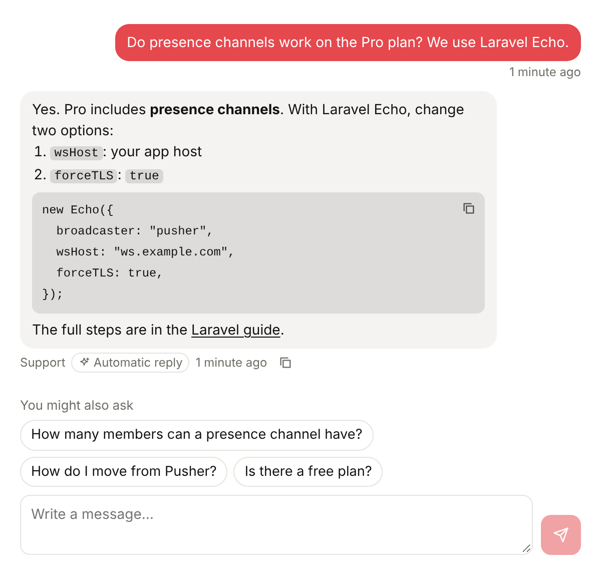
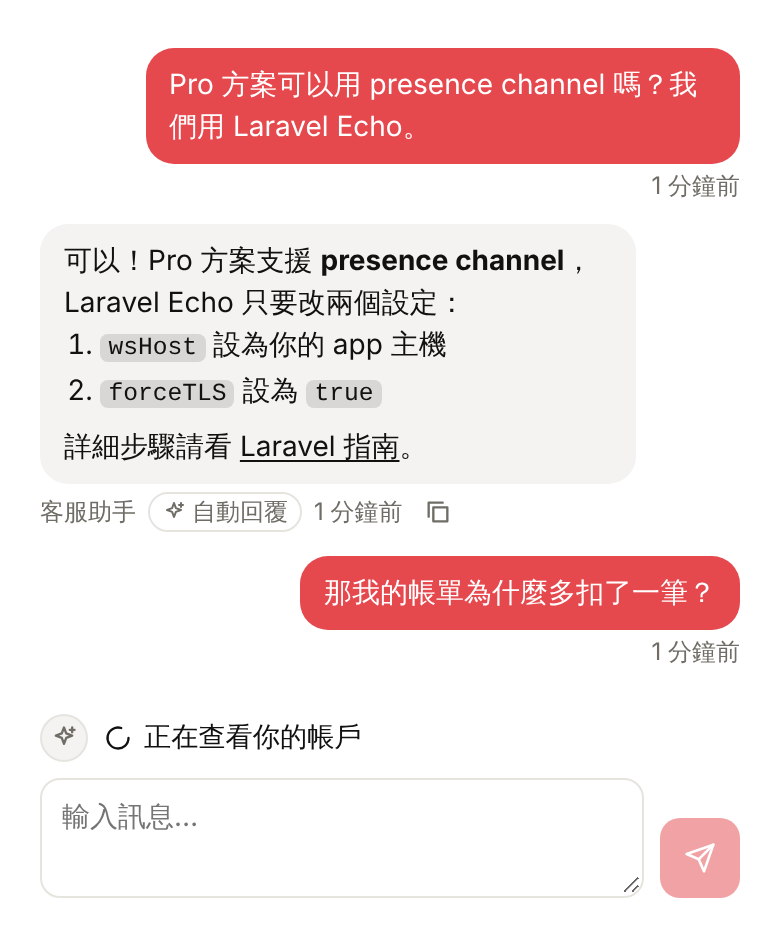
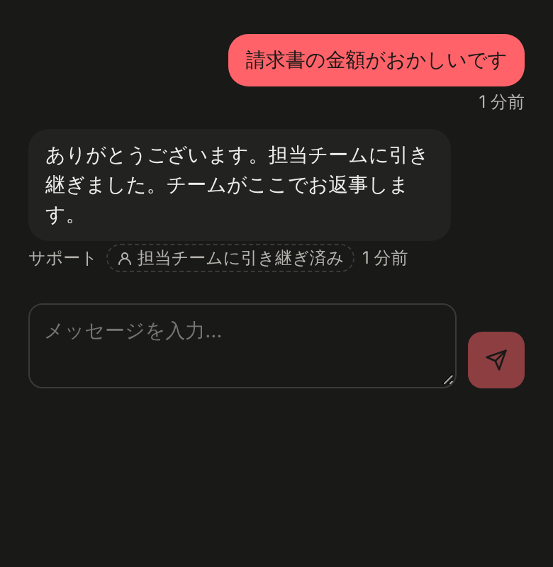

# chat-ui

A small, open-source chat interface for support conversations where an AI agent answers first and a person steps in when needed. It shows what the agent is doing while it writes, renders safe Markdown, offers follow-up questions, and marks when a conversation is handed to your team.



| Agent steps (zh-TW, mobile) | Handed to a person (ja, dark) |
| --- | --- |
|  |  |

- **Agent steps**: "Reading your question", "Looking at your account", "Writing a reply"… shown live, from hints your backend sends.
- **Safe Markdown**: parsed into elements, never HTML. Only http(s), mailto and same-site links; images show inline only from origins you allow.
- **Follow-up suggestions**: up to three short questions the customer can send with one tap.
- **Handoff**: a reply can say it was passed to a person, and the badge shows it.
- **Typewriter reveal**, copy buttons on replies and code blocks, a "Seen" marker.
- **Seven languages** built in: en, zh-TW, zh-CN, ja, ko, th, vi.
- **Small**: about 9 KB of JavaScript and 2 KB of CSS gzipped, no runtime dependencies. React is an optional peer.

It works with any backend. Messages live in your database and are read over HTTPS; a realtime channel on [Hibira](https://hibira.io) (or any Pusher-compatible service) only carries hints, so a missed event costs a poll, never a message. See [PROTOCOL.md](PROTOCOL.md).

## Install

```sh
npm install @hibira-io/chat-ui pusher-js
```

## React

```jsx
import { useEffect } from 'react';
import Pusher from 'pusher-js';
import { Chat, createConversation } from '@hibira-io/chat-ui/react';
import '@hibira-io/chat-ui/styles.css';

const pusher = new Pusher('YOUR_APP_KEY', { wsHost: 'ws.hibira.io', forceTLS: true, cluster: '' });

const conversation = createConversation({
  pusher,
  channel: `private-conversation-${conversationId}`,
  load: (after, signal) => fetch(`/api/conversations/${conversationId}/messages?after=${after}`, { signal }).then((r) => r.json()),
  send: (text) =>
    fetch(`/api/conversations/${conversationId}/messages`, {
      method: 'POST',
      headers: { 'Content-Type': 'application/json' },
      body: JSON.stringify({ text }),
    }).then((r) => r.json()),
});

export function SupportChat() {
  useEffect(() => conversation.start(), []);
  return <Chat conversation={conversation} locale="ja" />;
}
```

`load(after)` returns `{ messages: [...] }` with every message whose `seq` is greater than `after`. A message looks like:

```js
{
  seq: 12,
  sender: 'agent',            // or 'customer'; `me` (default "customer") is the person on this page
  text: 'Here is how to **rotate** a key…',
  created_at: '2026-10-31T09:00:00Z',
  metadata: { assistant: true, suggestions: ['How do I revoke the old key?'] },
}
```

The pieces are exported on their own too: `ChatThread` (controlled: pass `messages`, `typing`, `step`, `onSend`), `Markdown`, `AgentSteps`, `Suggestions`, `CopyButton` and `useReveal`.

## Without a framework

```js
import { createConversation, parseMarkdown } from '@hibira-io/chat-ui';

const conversation = createConversation({ pusher, channel, load, send });
conversation.subscribe((state) => render(state)); // { messages, loading, error, typing, step }
conversation.start();
```

`parseMarkdown(text, { origin, imageOrigins })` returns a plain block tree you can render with anything.

## Server (Node)

```js
import Pusher from 'pusher';
import { createChatServer, agentMetadata } from '@hibira-io/chat-ui/server';

const pusher = new Pusher({ appId, key, secret, host: 'api.hibira.io', useTLS: true });
const chat = createChatServer({ pusher });

const typing = chat.agentTyping(channel);       // "Reading your question", repeated every 4 s
typing.step('account');                         // "Looking at your account"
const answer = await yourAgent(question);
typing.step('writing');
typing.step('checking');
const msg = await db.saveMessage({
  sender: 'agent',
  text: answer.text,
  metadata: agentMetadata({ handoff: answer.handoff, suggestions: answer.suggestions }),
});
typing.stop();
await chat.message(channel, { seq: msg.seq, from: 'agent' });
```

`agentMetadata` keeps at most three short suggestions and drops any with links, line breaks or markup, since the customer sends them as their own words. Only send the steps your agent really goes through.

## Styling

Every color is a CSS variable on `.hb-chat`:

```css
.hb-chat {
  --hb-chat-accent: #3e63dd;
  --hb-chat-radius: 10px;
  --hb-chat-max-height: 480px;
}
```

Dark mode follows `prefers-color-scheme`, or set `data-theme="dark"` / `"light"` on any ancestor. Labels can be overridden one by one with `labels={{ handoff: 'With our support team' }}`.

## Safety

- Message text is never inserted as HTML.
- Links open only for `http:`, `https:`, `mailto:` and same-site paths, with `rel="noopener noreferrer"`.
- Images render inline only from `origin` and `imageOrigins`; any other image becomes a plain link, so a message cannot make the page load third-party content.
- Treat replies from your agent as untrusted text, like any customer message.

## License

MIT © Hibira
